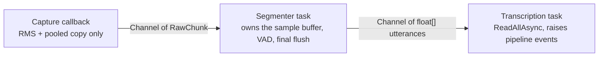

# Audio pipeline

From microphone to pasted text. The pipeline is `IAudioPipeline` (Core), implemented by
`AudioPipelineService` (Platform). The same service drives the desktop app and the
benchmark, so changes here move benchmark numbers.

Related ADRs: [003](../decisions/003-audio-pipeline.md) (original design),
[008](../decisions/008-incremental-vad-processing.md) (incremental VAD),
[011](../decisions/011-optimal-stt-pipeline-settings.md) (VAD and decoding settings),
[045](../decisions/045-audio-pipeline-allocation-threading.md) (current threading model),
[057](../decisions/057-cancel-dictation-on-command-shortcuts.md) (cancel),
[060](../decisions/060-hold-scoped-push-to-talk.md) (single-utterance mode and ceilings).

## Data flow

```mermaid
flowchart LR
    MIC["Microphone<br/>WASAPI via NAudio"]
    CAP["WasapiAudioCaptureService<br/>resample to 16 kHz mono float"]
    SEG["Segmenter<br/>Silero VAD via IVadService"]
    REC["ISpeechRecognizer<br/>DelegatingSpeechRecognizer"]
    CLEAN["ISpeechCleanupService<br/>opt-in, local model"]
    POST["TranscriptionTextProcessor"]
    VM["TranscribeViewModel<br/>TranscriptionAvailable"]
    INJ["ITextInjectionService<br/>clipboard paste or keystrokes"]
    WIN["Target window"]

    MIC --> CAP --> SEG -- "speech-only samples" --> REC --> CLEAN --> POST --> VM --> INJ --> WIN
```

1. **Capture.** `WasapiAudioCaptureService` captures from the selected microphone
   (`SettingsKeys.SelectedMicrophoneId`, resolved at pipeline start; an unplugged device
   falls back to the OS default) and resamples to 16 kHz mono float, the format every
   engine and the VAD take.
2. **Level.** The capture callback computes RMS for the waveform (`IAudioLevelProvider`,
   [ADR-023](../decisions/023-audio-level-waveform-visualisation.md)). All smoothing and
   animation happen in Desktop (`WaveformAnimation`), not in the pipeline.
3. **Segmentation.** Silero VAD (`IVadService` → `SileroVadService`) finds speech runs.
   VAD runs incrementally: only on audio that arrived since the last pass, and only once
   at least 500 ms has accumulated, because shorter chunks do not give the detector enough
   context for its padding and minimum-silence rules
   ([ADR-008](../decisions/008-incremental-vad-processing.md)). Adjacent runs are merged.
   `SpeechSegmentExtractor` concatenates only the speech runs, with a short silence
   between them, and drops the gaps.
4. **Recognition.** The speech-only samples go to the active recognizer (see
   [overview.md](overview.md#speech-engines)). When speech cleanup is on
   ([ADR-073](../decisions/073-speech-cleanup-s1-mini.md)) the text is then rewritten by a
   local model; the model starts loading when the recording starts, and any failure,
   timeout, non-English text or implausible result leaves the raw text in place. Last comes
   the shared text post-processor.
5. **Injection.** `TranscribeViewModel` handles `TranscriptionAvailable` and calls
   `ITextInjectionService`. The default `ClipboardTextInjectionService` saves the
   clipboard text, sets the transcript with the Windows clipboard-history exclusion
   formats, focuses the window `Win32TargetWindowTracker` last saw (the last
   non-Parlotype foreground window), sends Ctrl+V, and restores the saved text
   ([ADR-006](../decisions/006-text-injection-clipboard-vs-sharphook.md),
   [ADR-046](../decisions/046-security-hardening-batch.md)). Only text is saved and
   restored; see the [security audit](../security/2026-07-11-security-audit.md).

**VAD settings are benchmark-tuned.** The `VadOptions` defaults (padding, minimum silence,
the silence inserted between concatenated segments) were chosen by measuring WER
([ADR-011](../decisions/011-optimal-stt-pipeline-settings.md),
[`vad-tuning`](../knowledge/vad-tuning.md)). Concatenating segments with no silence between
them measurably hurts recognition. Change these values only with a benchmark run before
and after.

## Threading model

Since [ADR-045](../decisions/045-audio-pipeline-allocation-threading.md) the pipeline is
three single-threaded stages joined by unbounded `System.Threading.Channels`:

Rules:

- **The capture callback does no inference.** It computes RMS, copies the chunk into an
  `ArrayPool<float>` buffer and writes it to the raw channel. Slow work on the audio thread
  risks silent drops, because the capture buffer runs with `DiscardOnBufferOverflow`.
- **`AudioDataEventArgs.Buffer` is valid only during the event.** The capture service
  reuses its buffer when the handler returns; any subscriber must copy synchronously. This
  is part of the Core contract.
- **The segmenter task is the only owner of the sample buffer and the VAD state.** Nothing
  else touches them while the pipeline runs, which is why there is no buffer lock. A
  failure on one chunk is logged, the buffered audio is dropped, and the loop keeps
  running; a dead segmenter would stall the pipeline silently.
- **The transcription task reads utterances as they arrive** (no polling), calls the
  recognizer and raises `TranscriptionAvailable` or `TranscriptionFailed`. A failed
  utterance does not stop the recording: later utterances may succeed, and subscribers
  show the error ([ADR-043](../decisions/043-cloud-speech-providers-v1.md) amendment).
- **Model loading is serialized** behind `_initLock`, so a background prewarm
  ([ADR-038](../decisions/038-speech-model-prewarm-and-loading-state.md)) and an
  interactive start never load the model or snapshot settings concurrently.
- **Start and shutdown are serialized** behind `_lifecycleLock`. Nothing upstream
  guarantees that a stop or cancel never overlaps a start (the view model's cancel path
  deliberately does not wait for an in-flight start,
  [ADR-039](../decisions/039-ptt-stop-waits-for-inflight-start.md) and
  [ADR-057](../decisions/057-cancel-dictation-on-command-shortcuts.md)), and without the
  lock a stale shutdown could clear the fields of a session that had just started.
- **Settings are snapshotted at start.** Silence threshold, Whisper options, the text
  processor, the microphone and the utterance ceiling are read once per session; changes
  apply to the next recording.
- **Transcripts are never logged**, at any level. Log lengths and durations instead
  ([ADR-046](../decisions/046-security-hardening-batch.md), audit finding S1).
- **UI work dispatches to `Dispatcher.UIThread`.** Pipeline events arrive on the
  transcription task's thread.

### Stop and cancel

Both go through one `ShutdownAsync(discard, ct)`.

- **Stop** (drain): stop capture, complete the raw channel. The segmenter drains what is
  queued, runs a final VAD pass over the remaining buffer, flushes it as one last
  utterance and completes the utterance channel. The transcription loop drains and exits.
  The wait is capped at 30 s, since a recognizer may still be mid-utterance.
- **Cancel** (discard, [ADR-057](../decisions/057-cancel-dictation-on-command-shortcuts.md)):
  before the channel completes, set `_discarding` and cancel the session's recognizer
  token. The segmenter then skips its final flush and the transcription loop drains
  without recognizing. A cancel is not a failure and never raises `TranscriptionFailed`.
  The wait is capped at 5 s.
- **A result can outlive its session.** sherpa-onnx cannot observe cancellation inside a
  native decode, so a call in flight when cancel fired can return normally after the
  drain gave up waiting, possibly after a new session has started. The transcription
  loop therefore re-checks the token it was given at start, which stays bound to its own
  session, right before publishing.
- On the Desktop side, `TranscribeViewModel.CancelRecordingAsync` detaches its
  `TranscriptionAvailable` handler before calling `CancelAsync`, to cover an utterance
  that completed between the keystroke and the cancel.

## Modes

| Mode | Ends an utterance when | Used by |
|---|---|---|
| `Batch` | Silence after speech reaches `WaitTime` (minimum 500 ms, [ADR-019](../decisions/019-remove-sub-500ms-silence-threshold.md)). The buffer is force-flushed at 30 s of audio, as VAD-extracted speech rather than the raw buffer. | The widget's record button and toggle gestures |
| `SingleUtterance` | Only the explicit stop (key release). Splits only when accumulated speech exceeds the engine's ceiling, at a speech boundary. A 10-minute raw-buffer backstop guards against a missed key-up. | Hold gestures and push-to-talk chords ([ADR-060](../decisions/060-hold-scoped-push-to-talk.md)) |
| `Streaming` | Every 3 s window that contains speech | Nothing in the desktop app; kept with its tests |

`TranscribeViewModel.StartRecordingAsync(holdScoped)` chooses the mode: a gesture that
ends on key release runs `SingleUtterance`, because the release is a better
end-of-utterance signal than any silence timeout and letting silence cut first splits
sentences.

### Utterance ceilings

`SpeechEngineLimits.MaxUtteranceSeconds(engine)` is the longest audio one recognizer call
receives. It is measured against the speech the recognizer will actually get (the
extracted segments), not wall-clock hold time, so a hold full of thinking pauses is not
split for no reason.

- **Parakeet: 60 s, a correctness limit.** sherpa-onnx silently drops text as a single
  decode grows past this, and crashes in native code far beyond it.
- **Whisper: 300 s, a latency choice.** whisper.cpp chunks internally and kept its accuracy
  out to 600 s in the measurements.
- **Gemma 4 and the cloud engines** are unmeasured and use the Parakeet ceiling.

When the ceiling is reached, everything up to the last completed speech run is sent and
the last run stays buffered as the head of the next utterance. Only a single unbroken run
is cut mid-speech, with a warning in the log. The measurements are in
[`../research/2026-08-18-hold-scoped-push-to-talk/`](../research/2026-08-18-hold-scoped-push-to-talk/).
