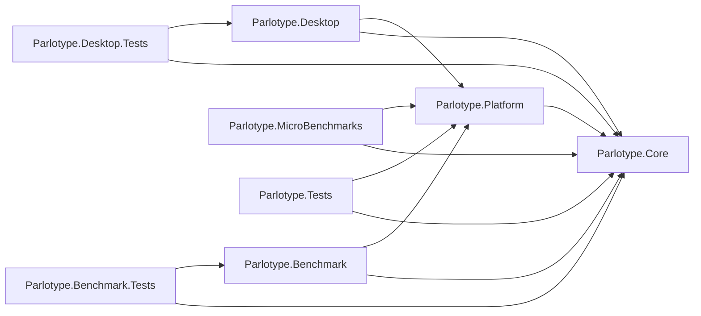

# Architecture overview

Parlotype is a tray-resident dictation app: a global hotkey starts the microphone, speech
is segmented and recognized, and the text is pasted into whatever window had focus. This
folder describes what the code does not say on its own: why the pieces are arranged this
way, the threading and lifecycle rules, and the flows that cross subsystems.

| Document | Covers |
|---|---|
| [overview.md](overview.md) | Projects and dependency direction, speech engines, external processes, glossary |
| [audio-pipeline.md](audio-pipeline.md) | Capture → VAD → recognizer → injection, the three-stage threading model, modes, shutdown and cancel |
| [subsystems.md](subsystems.md) | Hotkeys, language and translation, Whisper runtime selection, Transcribe window lifetime, packaging, paths and updates, feedback, startup, single instance, development runs |
| [llamacpp-subsystem.md](llamacpp-subsystem.md) | The managed `llama-server` sidecar used by Gemma 4 and by speech cleanup |

Decisions are recorded as ADRs in [`../decisions/`](../decisions/); this folder links to
them rather than repeating them. Dated research snapshots live in
[`../research/`](../research/).

**Keeping these docs true.** When a change makes a statement here false, edit that
statement in the same change. Do not add per-class inventories; the code is the inventory.

## Projects

The solution file `Parlotype.slnx` holds eight projects.

| Project | Role |
|---|---|
| `Parlotype.Core` | Contracts and pure domain logic. No platform packages; its only package reference is `Microsoft.Extensions.Logging.Abstractions`. |
| `Parlotype.Platform` | Implementations of the Core contracts on real dependencies (NAudio, SileroVad, Whisper.net, sherpa-onnx, SharpHook, Velopack, DPAPI). Its DI registrations are in `PlatformServiceExtensions.cs`; Desktop adds its own in `App.axaml.cs`. |
| `Parlotype.Desktop` | The Avalonia 12 tray app and entry point. Wires DI, owns windows, view models and the settings UI. |
| `Parlotype.Benchmark` | Console CLI that measures transcription quality (WER/CER/RTF) across engines and settings. See `src/Parlotype.Benchmark/README.md`. |
| `Parlotype.MicroBenchmarks` | BenchmarkDotNet suites for allocation and latency of hot paths ([ADR-044](../decisions/044-microbenchmark-project.md)). Not run by `dotnet test`. |
| `Parlotype.Tests` | xUnit v2 tests for Core and Platform. |
| `Parlotype.Desktop.Tests` | Avalonia headless UI tests on xUnit v3. |
| `Parlotype.Benchmark.Tests` | xUnit v2 tests for the benchmark's metrics, storage and reporting. |

Why this shape ([ADR-002](../decisions/002-solution-architecture.md)):

- **Core is the seam everything else meets at.** The benchmark, the desktop app and the
  tests all drive the same `IAudioPipeline` and `ISpeechRecognizer` contracts, so a
  benchmark result describes the code users run. Core holds pure logic too (for example
  `HotkeyGestureMatcher`, `SpeechSegmentExtractor`, `LanguageCatalog`, `AppPaths`) when it
  has no platform dependency and needs to be testable without a keyboard, a microphone or
  a model.
- **Platform owns every native dependency.** Native libraries, P/Invoke and external
  processes stay behind Core interfaces, which is what lets `Parlotype.Desktop.Tests`
  run headless with mocks.
- **Sentences shown to the user are worded in Desktop.** Core has no resources and must
  not get any. When Core needs to report something the user will read (a hotkey conflict,
  a cloud configuration error), it returns the reason as data (an enum and its
  arguments) and Desktop chooses the words. The English text kept in Core is the invariant
  form that log lines use ([ADR-064](../decisions/064-ui-localization-foundation.md)).

## Speech engines

All engines sit behind one `ISpeechRecognizer` contract. The registered singleton is
`DelegatingSpeechRecognizer`. On each `InitializeAsync` it asks `SpeechRecognizerFactory`
which engine `SettingsKeys.SpeechEngine` names and forwards every call to that recognizer.
An unset or unparsable value means Parakeet ([ADR-042](../decisions/042-parakeet-default-language-ux.md)).
Switching engines is an `UnloadAsync` → `InitializeAsync` cycle
([ADR-017](../decisions/017-whisper-model-hot-swap.md)); the pipeline above never knows
which engine it is talking to.

| `SpeechEngine` | Recognizer | Where it runs | Languages | Translation | ADR |
|---|---|---|---|---|---|
| `Parakeet` (default) | `ParakeetSpeechRecognizer` | In-process, sherpa-onnx, CPU only | 25 European, always auto-detected, no language UI | none | [041](../decisions/041-parakeet-v3-sherpa-onnx.md), [042](../decisions/042-parakeet-default-language-ux.md) |
| `Whisper` | `WhisperSpeechRecognizer` | In-process, Whisper.net, Vulkan or CPU | ~99, source selectable | to English only | [007](../decisions/007-whisper-model-selection-and-download.md), [021](../decisions/021-whisper-translation-to-english.md), [049](../decisions/049-drop-whisper-cuda-runtime.md) |
| `Gemma4` | `LlamaCppSpeechRecognizer` | `llama-server` child process on loopback | any (LLM, prompt-driven) | any target | [025](../decisions/025-gemma4-llamacpp-desktop.md), [037](../decisions/037-gemma4-source-target-prompts.md) |
| `OpenAiCompatible` (cloud) | `OpenAiCompatibleSpeechRecognizer` | HTTPS to `{base}/audio/transcriptions` (OpenAI, Groq, any compatible host) | auto-detected, no language UI | none | [043](../decisions/043-cloud-speech-providers-v1.md) |
| `XaiGrok` (cloud) | `XaiGrokSpeechRecognizer` | HTTPS to `{base}/stt` | auto-detected, no language UI | none | [043](../decisions/043-cloud-speech-providers-v1.md) |

Rules that hold across engines:

- **Local by default.** Audio leaves the machine only while a cloud engine is selected.
  Cloud engines are never the default, use the user's own key, and show a persistent
  Cloud badge on the Transcribe window while active
  ([ADR-032](../decisions/032-online-speech-providers-positioning.md)). Apart from the
  update check, which the app makes on its own, every network request follows a user
  action; [`../network-requests.md`](../network-requests.md) lists them all.
- **API keys never go in `settings.json`.** They live in `ISecretStore`
  (`secrets.json`, DPAPI-encrypted per value on Windows). A cloud engine with no key fails
  initialization with `CloudProviderNotConfiguredException`, which the record-start flow
  turns into a dialog with "Open settings".
- **Text post-processing happens once, in the pipeline**, for every engine, not inside
  recognizers. `AudioPipelineService` runs two steps in order: the opt-in speech cleanup
  (`ISpeechCleanupService`, a local model that rewrites the transcript as clean written
  text, [ADR-073](../decisions/073-speech-cleanup-s1-mini.md)), then
  `TranscriptionTextProcessor` (punctuation stripping, profanity mask). Cleanup never blocks
  a dictation: any failure pastes the raw text.
- **Each engine has an utterance ceiling** (`SpeechEngineLimits`): the longest audio one
  recognizer call may receive. For Parakeet it is a correctness limit, not a cost one. See
  [audio-pipeline.md](audio-pipeline.md#utterance-ceilings).
- **Adding an engine** means a `SpeechEngine` value, a recognizer in Platform registered
  in `PlatformServiceExtensions.cs`, a branch in `SpeechRecognizerFactory`, and a
  `LanguageCapabilities` entry in `SpeechEngineCapabilities.For`. The pipeline and the
  `ISpeechRecognizer` contract do not change; the cloud engines needed no changes there.

## External processes and native code

| Boundary | Purpose | Owner | ADR |
|---|---|---|---|
| `llama-server` (llama.cpp) | Gemma 4 inference, for the desktop app and the benchmark; speech cleanup (S1-mini) in the desktop app | `LlamaCppSpeechRecognizer` spawns or adopts one for Gemma 4; `LlamaServerSpeechCleanupService` spawns its own for cleanup. Installs are managed by the `LlamaServer` subsystem | [025](../decisions/025-gemma4-llamacpp-desktop.md), [026](../decisions/026-managed-llama-server-install.md), [027](../decisions/027-llamaserver-namespace-rescope.md), [073](../decisions/073-speech-cleanup-s1-mini.md) |
| whisper.cpp natives (Whisper.net) | Whisper inference, Vulkan or CPU | `WhisperSpeechRecognizer`, `WhisperRuntimeBootstrap` | [022](../decisions/022-vulkan-gpu-acceleration.md), [048](../decisions/048-whisper-runtime-latch-and-factory-lifetime.md), [049](../decisions/049-drop-whisper-cuda-runtime.md) |
| sherpa-onnx natives | Parakeet inference | `ParakeetSpeechRecognizer` | [041](../decisions/041-parakeet-v3-sherpa-onnx.md) |
| ONNX Runtime (via `SileroVad`) | Voice activity detection | `SileroVadService` | [008](../decisions/008-incremental-vad-processing.md), [050](../decisions/050-drop-onnx-runtime-gpu-providers.md) |
| libuiohook (via SharpHook) | Global keyboard hook, key simulation | `SharpHookHotkeyService`, text injection | [001](../decisions/001-global-hotkey-sharphook.md), [020](../decisions/020-sharphook7-simple-global-hook.md) |
| Win32 P/Invoke | Foreground window tracking, keyboard layout, Vulkan and NVIDIA probes, parent-process lookup | Platform services, each with a no-op on other OSes | [014](../decisions/014-nvidia-environment-detection.md), [022](../decisions/022-vulkan-gpu-acceleration.md), [036](../decisions/036-language-ux-rebuild.md), [062](../decisions/062-dev-parent-process-watchdog.md) |

`Directory.Build.targets` removes native files nothing loads (ONNX Runtime CUDA/TensorRT
providers, natives for other platforms, native PDBs) from build and publish output
([ADR-050](../decisions/050-drop-onnx-runtime-gpu-providers.md),
[ADR-051](../decisions/051-publish-only-target-rid-runtimes.md),
[ADR-052](../decisions/052-drop-native-pdbs-from-publish.md)). If a native library fails
to load only in an installed build, suspect those filters first.

## Glossary

| Term | Meaning |
|---|---|
| **Batch mode** | Pipeline mode that ends an utterance after a configurable silence (`WaitTime`, minimum 500 ms since [ADR-019](../decisions/019-remove-sub-500ms-silence-threshold.md)). Used by the widget's record button and toggle gestures. |
| **Single-utterance mode** | Pipeline mode for hold-scoped push-to-talk: silence never ends the utterance, the key release does ([ADR-060](../decisions/060-hold-scoped-push-to-talk.md)). |
| **Streaming mode** | Pipeline mode that cuts fixed 3-second windows. Kept in the pipeline and its tests; no gesture in the desktop app uses it. |
| **Utterance ceiling** | Longest audio a single recognizer call receives, per engine (`SpeechEngineLimits`). |
| **VAD** | Voice activity detection (Silero, via `IVadService`). |
| **Gesture** | One dictation binding: a chord, a held modifier or a double-tapped modifier, each with an activation mode ([ADR-047](../decisions/047-multi-binding-dictation-hotkeys.md)). |
| **Push-to-talk / Toggle** | Activation modes: record while held, or press to start and press again to stop. |
| **Text injection** | Putting the recognized text into the target window: clipboard paste with restore (default) or simulated keystrokes ([ADR-006](../decisions/006-text-injection-clipboard-vs-sharphook.md)). |
| **Runtime preference** | Whisper backend choice: `Auto`, `Vulkan` or `Cpu`. `Vulkan` and `Cpu` are strict ([ADR-022](../decisions/022-vulkan-gpu-acceleration.md), [ADR-048](../decisions/048-whisper-runtime-latch-and-factory-lifetime.md), [ADR-049](../decisions/049-drop-whisper-cuda-runtime.md)). |
| **Translation form** | What translation an engine offers: `Full` (any target, Gemma 4), `Toggle` (one fixed target, Whisper to English) or `None`. |
| **BYOK** | Bring your own key: cloud engines use the user's own API key. |
| **Sidecar** | A `llama-server` child process on `127.0.0.1`: one serves Gemma 4, another serves the speech cleanup model. |
| **Speech cleanup** | The opt-in pass that rewrites recognized text as clean written text with a local model before it is pasted ([ADR-073](../decisions/073-speech-cleanup-s1-mini.md)). |
| **Pack folder** | `%LOCALAPPDATA%\Parlotype`, owned by Velopack and deleted on uninstall. Nothing user-owned may live there ([ADR-053](../decisions/053-velopack-packaging-and-auto-update.md)). |
| **GGML / GGUF** | Model file formats for whisper.cpp and llama.cpp. |
| **WER / CER / RTF** | Benchmark metrics: word and character error rate, real-time factor. |
