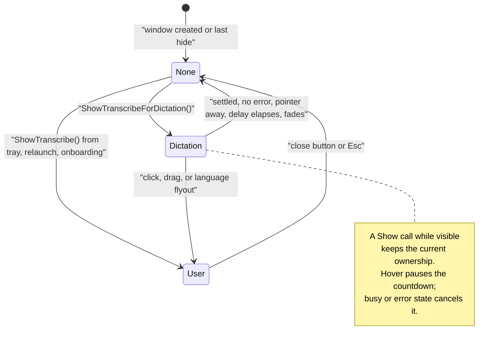

# Subsystems

The parts of Parlotype whose rules are not obvious from reading one class. Each section
says why it works the way it does and links the ADRs that decided it. For the recording
path itself see [audio-pipeline.md](audio-pipeline.md); for engines and projects see
[overview.md](overview.md).

- [Global hotkeys](#global-hotkeys)
- [Language and translation](#language-and-translation)
- [Whisper runtime selection](#whisper-runtime-selection)
- [Transcribe window lifetime](#transcribe-window-lifetime)
- [Settings, secrets and window state](#settings-secrets-and-window-state)
- [Packaging, app paths and updates](#packaging-app-paths-and-updates)
- [Feedback](#feedback)
- [Launch at sign-in](#launch-at-sign-in)
- [Onboarding tour](#onboarding-tour)
- [Localization](#localization)
- [Single instance and activation](#single-instance-and-activation)
- [Running in development](#running-in-development)

---

## Global hotkeys

Users configure a list of gestures, not one chord
([ADR-047](../decisions/047-multi-binding-dictation-hotkeys.md)).

- **Model.** A `DictationHotkey` is a `HotkeyGesture` plus an `ActivationMode`. A gesture
  is a chord, a held modifier or a double-tapped modifier; modifiers carry a side (Left,
  Right, Either). The kind constrains the mode: holds are push-to-talk only, double-taps
  are toggle only, chords can be either.
- **Defaults** (`DictationHotkeyDefaults`): hold Right Ctrl (push-to-talk), double-tap
  Ctrl (toggle), Ctrl+Alt+Space (toggle). Escape cancels and is not configurable.
- **Recognition is pure Core logic.** `HotkeyGestureMatcher` turns timestamped key events
  into Start / Stop / Cancel plus a suppression decision, so all gesture timing is
  testable without a keyboard. Thresholds are in `HotkeyGestureTiming`. A tap counts only
  if no other key went down in between; otherwise Ctrl+C followed by Ctrl+V would read as
  a double-tap.
- **Deferred hold start.** When a double-tap binding shares a hold binding's key (as the
  defaults do), the hold waits out the tap window before starting, so a deliberate
  double-tap does not flash a recording into existence.
- **Platform adapter.** `SharpHookHotkeyService` wraps `SimpleGlobalHook`, which is
  required for event suppression to work
  ([ADR-020](../decisions/020-sharphook7-simple-global-hook.md)). It owns a timer for
  deferred holds, so the matcher is reached from two threads and is lock-guarded.
- **Suppression.** Chords are suppressed on key down and key up. Bare modifiers are never
  suppressed: that would break every Ctrl shortcut. Escape is suppressed only while
  dictation is active.
- **The hook cannot see dictation state**, but toggle and Escape need it (a recording can
  start from the widget button, or fail to start). `HotkeyCoordinator` feeds it in through
  `IGlobalHotkeyService.SetDictationActive`.
- **Holds abort on shortcuts** ([ADR-057](../decisions/057-cancel-dictation-on-command-shortcuts.md)).
  A keystroke during a hold means the user reached for a shortcut, so the recording is
  discarded. Under Ctrl and Alt this applies to any keystroke at any time, because nothing
  typed under a command modifier can be text. Shift and Meta holds abort only within a
  short grace window after the hold starts, since users do type while dictating. Toggle
  dictation is unaffected: Ctrl+S during it saves the file and keeps recording. The
  shortcut itself still reaches the target app.
- **Hold-scoped sessions.** A gesture that ends on key release starts the pipeline in
  single-utterance mode ([ADR-060](../decisions/060-hold-scoped-push-to-talk.md)).
- **Validation.** `HotkeyConflictDetector` blocks OS-reserved chords and duplicates and
  warns about chords that collide in practice (Ctrl+Shift+Space for IDE parameter hints,
  Ctrl+Alt+letter for AltGr). It returns the reason as data; Desktop's `HotkeyText` words
  it and formats every gesture for display. Core's `DisplayString` is the invariant form
  used in logs.
- **Persistence.** `SettingsKeys.HotkeyBindings` holds a readable string list encoded by
  `HotkeyBindingCodec` (for example `hold|Ctrl|Right|PushToTalk`). The pre-ADR-047 single
  chord is migrated once by `HotkeySettingsMigrator`. Modifier sides are resolved from
  SharpHook's event mask ([`sharphook-modifier-sides`](../knowledge/sharphook-modifier-sides.md)).

## Language and translation

One shared model answers "what does the user speak, and what should be typed"
([ADR-034](../decisions/034-source-target-language-selection.md) data model,
[ADR-036](../decisions/036-language-ux-rebuild.md) UX,
[ADR-061](../decisions/061-translation-paused-state.md) paused state).

- **Capabilities drive the UI.** Each engine declares `LanguageCapabilities`
  (`SpeechEngineCapabilities.For`). Its derived `TranslationForm` is `Full` (any target,
  Gemma 4), `Toggle` (one fixed target, Whisper to English) or `None`. When an engine has
  no language choice at all (`HasLanguageChoices` is false: Parakeet and both cloud
  engines) the Language settings page and the Transcribe widget's language strip are
  hidden, and the widget compacts from 118 to 88 px
  ([ADR-042](../decisions/042-parakeet-default-language-ux.md)). Adding an engine means
  declaring capabilities, not editing views.
- **One view model behind both surfaces.** `LanguageRelationshipViewModel` (a singleton)
  owns source, target, translation state, recent-language lists and engine-switch
  fallbacks for both the settings page and the widget. When an engine switch invalidates a
  choice, it falls back and says so in a toast rather than changing it silently. A change
  to the relationship stops an active recording.
- **Sentinels.** Source can be `auto`, an explicit language, or `keyboard`, which resolves
  at record time to the foreground window's keyboard layout (layouts are per thread on
  Windows; `Win32KeyboardLayoutService`), falling back to auto-detect. A blank source
  means auto, never keyboard.
- **Paused, not disabled.** With Whisper, translation to English needs a multilingual
  model. If the selected model cannot translate, translation is shown as paused: the toggle
  stays on and operable, the UI names the model and offers a way to pick one that
  translates, and the preference resumes by itself
  ([ADR-061](../decisions/061-translation-paused-state.md)). The pipeline gates the
  translate flag on model capability regardless of what the UI shows
  ([ADR-033](../decisions/033-translation-model-capability.md)).
- **Gemma 4 prompts.** The prompt body is chosen per transcription from a source/target
  matrix, with `{speech_lang}` and `{text_lang}` substituted by name
  ([ADR-030](../decisions/030-configurable-gemma4-prompts.md),
  [ADR-037](../decisions/037-gemma4-source-target-prompts.md)).
- **Migration.** Legacy `TranslateToEnglish` and the shared recent-languages list are
  migrated once by the idempotent `LanguageSettingsMigrator`, which runs from
  `AudioPipelineService` and `LanguageRelationshipViewModel`, so the first read of the new
  keys from either side triggers it.

## Whisper runtime selection

`RuntimePreference` (`Auto` / `Vulkan` / `Cpu`) picks the Whisper.net native backend.
Vulkan is the only GPU runtime; it works on AMD, Intel and NVIDIA
([ADR-022](../decisions/022-vulkan-gpu-acceleration.md),
[ADR-048](../decisions/048-whisper-runtime-latch-and-factory-lifetime.md),
[ADR-049](../decisions/049-drop-whisper-cuda-runtime.md)).

| Preference | Library order | Fallback |
|---|---|---|
| `Auto` (default) | Vulkan, then CPU | silent |
| `Vulkan` | Vulkan | none: throws `RuntimeUnavailableException` |
| `Cpu` | CPU | none |

- **Process-global, one shot.** `WhisperRuntimeBootstrap.Initialize` sets Whisper.net's
  library order once per process; the first call wins. A changed preference therefore
  needs a restart. Settings → Speech engine → Whisper runtime shows a "Restart required"
  panel when the selection differs from what is loaded.
- **Strict means strict, and it is checked early.** Before downloading a model,
  `WhisperSpeechRecognizer` checks that the loaded (latched) runtime still satisfies the
  preference and throws `RuntimeUnavailableException { RequiresRestart = true }` if not.
  This applies to `Cpu` too: a CPU selection under a latched GPU runtime is an error, not
  a silent GPU run. For strict `Vulkan` it also consults `IVulkanEnvironmentProvider`
  first. `TranscribeViewModel` turns the exception into a status message pointing to
  Settings.
- **Never let a `WhisperFactory` escape a failed init.** It owns the native model context
  and has no finalizer. The factory is disposed on any verification or build failure and
  published only after the processor exists
  ([`whisper-net-quirks`](../knowledge/whisper-net-quirks.md)).
- **Stale values.** A `"Cuda"` value written before ADR-049 is unparsable; every reader
  degrades it to `Auto`, and the runtime settings page rewrites it.
- **Environment probes.** `IVulkanEnvironmentProvider` probes the Vulkan loader and
  devices by P/Invoke. It gates strict Vulkan, dims unavailable options in Settings, and
  writes a startup log line. `INvidiaEnvironmentProvider`
  ([ADR-014](../decisions/014-nvidia-environment-detection.md)) still runs at startup but
  only writes a diagnostic log line; nothing selects CUDA any more. Both are cached after
  the first probe, failure-isolated, and replaced by no-op providers off Windows.

Gemma 4 is separate: `llama-server` builds, including CUDA ones, are chosen and installed
at runtime (see [llamacpp-subsystem.md](llamacpp-subsystem.md)).

## Transcribe window lifetime

Who shows the dictation widget, and who makes it go away
([ADR-040](../decisions/040-frameless-compact-transcribe-window.md) frameless chrome,
hide-don't-close; [ADR-068](../decisions/068-transcribe-window-auto-hide.md) auto-hide).

- **Two kinds of ownership.** `IWindowManager.ShowTranscribe(activate)` is the
  user-summoned path (tray click, tray Open, relaunch of a running instance, onboarding)
  and makes the window `User`-owned: sticky. `ShowTranscribeForDictation()` is called only
  by `HotkeyCoordinator` on a hotkey press and makes it `Dictation`-owned: transient. A
  separate method, rather than a reason parameter, keeps the other call sites unchanged.
  A window that is already visible keeps its ownership, so a dictation gesture never
  demotes a window the user opened.
- **Only one way it disappears unasked.** A `Dictation`-owned window fades out and hides
  about 1.5 s after the session has fully settled. A `User`-owned window hides only via ✕
  or Esc. Any hide resets ownership.
- **"Settled" is `TranscribeViewModel.IsDictationBusy`, not `IsRecording`.** `IsRecording`
  goes false when the pipeline finishes draining, but text injection (clipboard save, set,
  paste, restore) runs after that in an `async void` handler. `IsDictationBusy` combines a
  pending start, recording, model loading and an in-flight injection counter, so a paste
  in progress is not mistaken for the end.
- **A failed session stays visible.** `IsInErrorState` (runtime unavailable, restart
  required, cloud failure or missing configuration) blocks auto-hide; the widget staying
  up is the "needs attention" signal. A user cancel is a clean end and hides normally.
- **Engagement.** Hovering a transient window pauses its countdown. A press on the window
  or opening its language flyout promotes it to `User` for the rest of that visible
  lifetime. `Window.Activated` is deliberately not an engagement signal: the dictation
  path shows the window without activation, and if Windows activated it anyway every
  auto-summoned window would count as engaged and never hide.
- **Testable timing.** `TranscribeAutoHideController` (one per window, owned by
  `WindowManager`, not DI) runs its delay through an injectable provider, so headless
  tests step it instead of sleeping. The exit is a short opacity fade; the entrance is
  never animated, because the widget appearing is the user's confirmation that the hotkey
  registered.



## Settings, secrets and window state

- **Three files, on purpose.** `settings.json` (`JsonSettingsService`) holds preferences;
  `secrets.json` (`DpapiSecretStore`) holds cloud API keys, DPAPI-encrypted per value on
  Windows and base64 with a one-time warning elsewhere
  ([ADR-043](../decisions/043-cloud-speech-providers-v1.md)); `window-state.json` holds
  widget position, kept separate so frequent window-drag saves never contend with or risk
  user settings. All three are written atomically through `AtomicFileWriter`
  ([ADR-046](../decisions/046-security-hardening-batch.md)): a crash used to leave a
  truncated file that loaded as empty, silently losing keys.
- **Readers are defensive.** Settings values are parsed with `TryParse` and a default, so
  a malformed file cannot crash startup, and an unknown enum value degrades to the default
  (for example, an unknown engine means Parakeet).

## Packaging, app paths and updates

Velopack packaging, installer and auto-update
([ADR-053](../decisions/053-velopack-packaging-and-auto-update.md); release procedure in
[`../RELEASING.md`](../RELEASING.md)).

### App paths: the constraint that shapes everything

Velopack installs to `%LOCALAPPDATA%\Parlotype` (the pack id, permanent) and deletes that
whole folder on uninstall and on a `Setup.exe` re-run. Windows paths are
case-insensitive, so the old data root `%LOCALAPPDATA%\parlotype` was that same folder
([`velopack-pack-folder-is-destructive`](../knowledge/velopack-pack-folder-is-destructive.md)).

- **`IAppPaths` is the single source of truth for every write path**, with
  `AppPaths.Default` for code that runs before DI. The Windows root is
  `%LOCALAPPDATA%\parlotype-data`; macOS uses `~/Library/Application Support/Parlotype`
  and `~/Library/Logs/Parlotype`; Linux uses the XDG data, config and state directories.
  Never compose a write path by hand. A test fails the suite if any path lands inside the
  pack folder.
- **No automatic migration.** Existing pre-ADR-053 installs move their data by hand
  ([`../RELEASING.md`](../RELEASING.md#migrating-from-a-pre-adr-053-install)).
- **User-supplied paths are warned about, never rewritten.** `VelopackPackFolder` checks
  paths `IAppPaths` cannot constrain, today the manual `llama-server` folder, and the
  settings page shows a warning if one points inside the pack folder
  ([ADR-065](../decisions/065-manual-llama-server-pack-folder-warning.md)).
- **One llama-server location.** Managed installs live under
  `IAppPaths.LlamaServerInstallsDirectory`. There is no default manual folder; an
  unconfigured server is reported as unconfigured
  ([ADR-066](../decisions/066-drop-the-vestigial-llama-server-directory.md)).

### Entry point

`VelopackApp.Build().Run()` is the first statement in `Program.Main`. Velopack re-invokes
the same executable with hook arguments and expects it to handle them and exit within
seconds, so nothing may initialize first; `vpk pack` checks this. DI and ZLogger do not
exist yet at that point, so hooks log through `VelopackFileLogger` to `velopack.log`.

### Uninstall

User data is kept on uninstall by default. The uninstall hook may not show UI, so it
cannot ask. The user records the choice in advance at Settings → Application → Data
(`SettingsKeys.UninstallRemovesUserData`, default false), and the hook executes it. The
hook parses `settings.json` itself, since there is no DI; anything ambiguous reads as
false, so data is deleted only on an unambiguous opt-in. "Delete downloaded models…"
first unloads the recognizer and stops `llama-server`, because Windows locks loaded model
files. Windows only; macOS and Linux have no uninstall hooks.

### Updates

`VelopackUpdateService` checks the public GitHub Releases feed 30 s after startup and then
every six hours, downloads in the background and applies on restart. It is the only
request the app makes on its own: an anonymous GET with no machine id, install id or usage
data. It is on by default (`SettingsKeys.UpdatesCheckAutomatically`), disclosed in the
README and on Settings → Application → Updates, and can be turned off there. Dev and
portable builds are not installed, so the service no-ops for them.

Every other request follows a user action: opening Settings (the llama.cpp release list),
a model or `llama-server` download, a cloud engine, or Send in the feedback window.
[`../network-requests.md`](../network-requests.md) is the full list. It, the README's
Updates section and Settings → Updates must say the same thing, and a new outbound request
needs an ADR.

## Feedback

The "Send feedback" window, opened from the tray menu and Settings → Help, posts a message
or bug report to `https://parlotype.dev/api/feedback`
([ADR-070](../decisions/070-send-feedback-from-the-app.md)).

- **The contract is not in this repository.** It lives in the website repository
  (`docs/feedback-api.md`) and is public, and released app versions depend on it. Changing
  a field or a status code means a new API version on the server plus an app release, not
  an edit here. `FeedbackLimits` mirrors the server's field limits so the dialog enforces
  exactly what the server would; it must never be stricter than the server.
- **One POST per press of Send, and nothing else.** No retry, no queue, no background or
  crash-time send: a request the user did not just ask for would be a new kind of network
  traffic. No secret either, since anything shipped in the binary can be extracted (the
  server relies on rate limits and a kill switch), and no `User-Agent`, cookies or
  redirects, because a `User-Agent` would carry the app version even when the user
  unticked it and a redirect would send the message somewhere the dialog did not name.
  `HttpFeedbackService` owns its `HttpClient` with a 15 s timeout; the shared one has a
  one-hour timeout for model downloads.
- **Failures are results.** Responses are classified on status and the contract's `error`
  code together; anything unrecognized is a server error. Every failure except an invalid
  email or a rate limit offers the fallback, which copies the message to the clipboard and
  opens the website's feedback form or GitHub Issues. The URL carries only the language.
- **The draft lives in memory.** `FeedbackViewModel` is a DI singleton while the window is
  rebuilt on each open, so text survives closing the window for the rest of the session.
  It is never written to disk, and a successful send clears it.
- **Testing never touches production.** `PARLOTYPE_FEEDBACK_ENDPOINT` overrides the
  endpoint in Debug builds only (Release builds compile the check out), and the service
  logs a warning when it is overridden. Tests hand a fake `HttpMessageHandler` to the
  internal constructor. Never send a test message to the production endpoint: each one
  reaches the developer's inbox. The local-Worker recipe is in
  [`local-feedback-worker-testing`](../knowledge/local-feedback-worker-testing.md).

## Launch at sign-in

Installed builds start at sign-in, on by default
([ADR-059](../decisions/059-launch-at-sign-in.md)).

- `WindowsRunKeyLaunchAtLoginService` writes the per-user `HKCU` Run key and registers the
  Velopack stub at the install root, never the versioned `current\` executable, which is
  replaced on update. Only Velopack-installed builds register; a `dotnet run` build is
  `Unsupported`, so a dev machine never gets an autorun entry.
- **The OS gets a vote.** Task Manager can disable a startup entry by writing
  `…\Explorer\StartupApproved\Run`, separately from the Run key. The state is therefore
  four-valued (`Unsupported`, `Disabled`, `Enabled`, `BlockedByOperatingSystem`), not a
  bool. Parlotype detects and explains the blocked state but never writes the approval
  value ([`windows-run-key-startup-approval`](../knowledge/windows-run-key-startup-approval.md)).
- `LaunchAtLoginCoordinator` owns the default-on policy: an absent preference means on, so
  upgrades adopt it too. It writes only when preference and OS state differ. `App`
  reconciles once at startup, off the UI thread, and the first-run tour discloses it.

## Onboarding tour

A first-run tour of eight steps that points at real controls
([ADR-056](../decisions/056-first-run-onboarding-wizard.md)). Desktop only.

- `OnboardingService` stamps `SettingsKeys.OnboardingCompleted` before showing the tour,
  so a crash mid-tour does not repeat it on every launch. It is not tied to Velopack, so
  updaters and dev builds also see it once. Settings → Help relaunches it.
- Steps reference controls by id (`OnboardingTarget.Id` attached property). Highlighting
  attaches an adorner by scanning the visual tree; a missing or invisible target is
  skipped, never an error. The recording step lists the user's actual bindings and never
  reinstates defaults the user removed.

## Localization

The rules for user-facing text (resx, the translation pipeline, live language switching,
what stays English) live in the `localization` skill
(`.claude/skills/localization/SKILL.md`) and the decisions in
[ADR-064](../decisions/064-ui-localization-foundation.md) and
[ADR-069](../decisions/069-twenty-five-ui-languages.md). Two architectural points:

- Switching is live because `{loc:Tr Key}` compiles to a binding on a per-key
  `LocalizedString` object, not a reflection binding. Copy composed in C# is a snapshot
  and must be rebuilt on culture change; keep the input, not the finished string.
- `CurrentUICulture` follows the chosen interface language; `CurrentCulture` does not, so
  dates and numbers keep following the user's Windows regional settings.

## Single instance and activation

One instance per logon session ([ADR-055](../decisions/055-single-instance-guard.md)).

- **Why it matters.** Every extra process installs its own global keyboard hook, so one
  hotkey press reaches all of them: several recordings start and whichever finishes first
  injects text. Event suppression makes the ordering worse, not better.
- `SingleInstanceGuard` takes the named mutex `Local\Parlotype.SingleInstance` in
  `Program.Main`, after `VelopackApp.Run()` (hook invocations re-enter the same exe and
  must not be turned away) and before Avalonia starts. A losing launch signals the primary
  through a named event and exits; the primary opens its Transcribe window, so relaunching
  a tray-only app visibly does something. The event exists from the moment the mutex is
  won, so a signal during startup is not lost.
- **Session-scoped** (`Local\`): a second signed-in user gets their own instance.
- **Fail-open.** An abandoned mutex (killed instance) counts as acquired; any other
  failure is logged to `velopack.log` and treated as primary. Not starting is worse than
  starting twice.
- Named events throw on Unix, so on macOS and Linux a second launch just exits.

## Running in development

```bash
dotnet run --project src/Parlotype.Desktop
```

- The app starts hidden: only the tray icon shows. A dictation hotkey opens the Transcribe
  window and starts recording.
- **Quit the installed app first.** Because of the single-instance guard, a `dotnet run`
  build otherwise defers to the installed one and exits.
- **A dev build exits with its launcher** ([ADR-062](../decisions/062-dev-parent-process-watchdog.md)).
  An IDE or `dotnet run` session stopped abnormally used to leave the real `Parlotype`
  child alive with no window, still holding the keyboard hook and injecting text, and the
  single-instance guard then made every later run defer to it. `ParentProcessExitWatcher`
  resolves the parent process (`NativeParentProcess`, via `NtQueryInformationProcess`),
  and when the parent exits shuts the app down, with a hard exit after a short grace. It
  does nothing for installed builds, off Windows, or when the parent cannot be resolved to
  a live process. The `desktop.Exit` handler disposes the hotkey coordinator and the
  watcher before its first `await`, so a stranded continuation cannot leave the hook
  installed.
- **The XAML previewer is not a Parlotype run**
  ([ADR-063](../decisions/063-xaml-previewer-must-not-start-the-app.md)). Rider and Visual
  Studio load `Parlotype.dll` and call `Program.BuildAvaloniaApp()` without running
  `Program.Main`, so there is no single-instance guard and no desktop lifetime to shut
  anything down. Without a guard it started the global hook, the microphone and a
  prewarmed model inside the IDE's process. `App.OnFrameworkInitializationCompleted`
  returns before building the container when `Design.IsDesignMode` is set or there is no
  desktop lifetime; the two checks are independent so neither is a single point of
  failure. The cost: previews render in the default theme. If a `dotnet.exe` with no tray
  icon answers the dictation hotkey, check its parent process.
- **Logs** go to `IAppPaths.LogsDirectory` as `parlotype-v2-{yyyy-MM-dd}_{seq}.log`, rolling
  daily and at 10 MB. The file sink records `Information` and above; the console gets
  `Debug`.
- **Avalonia DevTools.** Debug builds reference `AvaloniaUI.DiagnosticsSupport` and call
  `AttachDeveloperTools()`; the classic `Avalonia.Diagnostics` inspector does not exist in
  Avalonia 12 ([ADR-016](../decisions/016-avalonia12-developer-tools.md)). Install the
  inspector once with `dotnet tool install --global AvaloniaUI.DeveloperTools`, run
  `avdt`, then press F12 in the running app. Release builds carry none of it.
